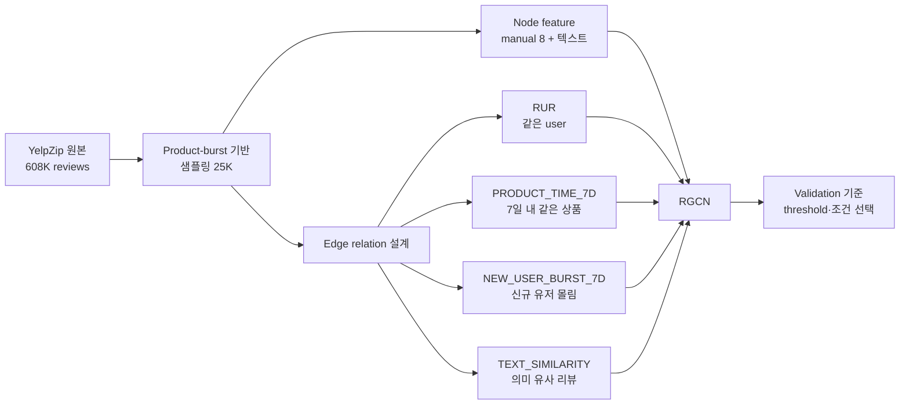

# GNN 기반 조직적 가짜 리뷰 네트워크 탐지

> 리뷰 한 건의 텍스트만 보는 대신, **리뷰 사이의 관계(같은 작성자·짧은 기간의 같은 상품·신규 유저 몰림·의미적으로 유사한 리뷰)** 를 관계별 그래프로 만들고
> Relation-aware GNN(RGCN)으로 학습해 **조직적으로 작성된 fake review**를 탐지한 프로젝트입니다.


ITDA 수도권 데이터사이언스 연합 학회 2026-1 학술제 · 경희대 CODE 1조 (4인) · 2026.03–06
**담당: 데이터 전처리, 그래프·엣지 설계, 모델 실험과 ablation, 결과 해석까지 전 과정 주도**

---

## 한눈에 보기

| 항목 | 내용 |
| --- | --- |
| 문제 | YelpZip 식당 리뷰(608,458건, fake 13.2%)에서 fake review 이진 분류 |
| 핵심 아이디어 | review를 node로 두고, 서로 다른 의미의 관계를 서로 다른 relation으로 분리해 RGCN으로 학습 |
| 실험 설계 | 25,000건 샘플·동일 split을 모든 모델에 고정 → 성능 차이를 feature/edge 설계 변화로만 해석 |
| 최종 성능 | **Test PR-AUC 0.5909 · Macro F1 0.7212 · Accuracy 0.8158** |
| 개선폭 | GraphSAGE 0.5400 → RGCN baseline 0.5689 → 최종 0.5909 (PR-AUC) |

---

## 접근 방식



같은 user가 쓴 리뷰, 짧은 기간 같은 상품에 몰린 리뷰, 신규 유저들의 집중, 의미가 비슷한 리뷰는 **서로 다른 fake 패턴**입니다.
이를 하나의 엣지로 합치는 GraphSAGE 대신, relation마다 별도 가중치를 학습하는 **RGCN**을 선택했고 실험으로 검증했습니다 (동일 조건에서 PR-AUC +0.029).

---

## 단계별 모델 발전

한 번에 최종 모델을 만들지 않고, 한 단계에 한 가지만 바꿔 개선 근거를 확인했습니다.

| 단계 | 바꾼 것 | Test PR-AUC | Macro F1 | Accuracy |
| --- | --- | ---: | ---: | ---: |
| GraphSAGE (비교 기준) | relation 구분 없음 | 0.5400 | 0.6985 | 0.7988 |
| Model 1 | manual 8 + TF-IDF/SVD 32 + behavioral edge 3종 + RGCN | 0.5689 | 0.7130 | 0.8066 |
| Model 2 | 텍스트를 SBERT 384로 교체 + RGCN 튜닝 | 0.5789 | 0.7075 | 0.8088 |
| Model 3-1 | SBERT를 PCA 128로 압축 (train에만 fit) | 0.5823 | 0.7070 | 0.7980 |
| Model 3-2 | TEXT_SIMILARITY edge 추가 | 0.5909 | 0.7187 | 0.8120 |
| **Model 3 Final** | **유사도 조건을 validation grid search로 선택** | **0.5909** | **0.7212** | **0.8158** |

**주요 발견**

- **신규 유저 몰림 엣지가 핵심 신호** — Model 1에서 `NEW_USER_BURST_7D`를 빼면 PR-AUC가 0.0246 하락. 단일 ablation 중 가장 큰 효과
- **SBERT는 그대로 쓰면 오히려 하락** — 384차원 교체만으로는 0.5689 → 0.5661. 튜닝 후에야 개선되어, 차원 증가에 따른 노이즈를 확인
- **텍스트 의미를 node feature가 아니라 관계로 표현할 때 효과** — 같은 node feature에서 TEXT_SIMILARITY edge만 추가해 +0.0086

---

## 최종 모델

```text
node feature : manual 8 + SBERT(all-MiniLM-L6-v2) PCA 128  → 136차원
edge         : RUR / PRODUCT_TIME_7D / NEW_USER_BURST_7D / TEXT_SIMILARITY  (357,688 directed edges)
TEXT_SIM     : 같은 상품·다른 작성자·20자 이상 리뷰 중 cosine ≥ 0.85, top_k = 5 (validation PR-AUC로 선택)
model        : RGCN, hidden 32, dropout 0.5, lr 0.002, weight_decay 5e-4, early stopping 40
imbalance    : pos_weight = train negative / positive
threshold    : validation Macro F1 기준 선택 (0.68) 후 test에 그대로 적용
```

| Test Confusion Matrix | Pred Normal | Pred Fake |
| --- | ---: | ---: |
| True Normal | 3,496 | 478 |
| True Fake | 443 | 583 |

이 외에 상품 단위로 의심 점수를 집계한 case study와, 동일 파이프라인을 **Amazon 리뷰 데이터에 재적용한 확장성 검증**까지 진행했습니다.

---

## 저장소 구조

```text
├─ model1/   behavioral edge 기반 baseline RGCN + GraphSAGE 비교 + edge ablation
├─ model2/   SBERT text feature + tuned RGCN
├─ model3/   SBERT PCA 128 + TEXT_SIMILARITY edge + 최종 grid search
│   ├─ notebooks/   단계별 실행 스크립트 (01 → 10)
│   ├─ configs/     feature·edge 설정
│   └─ outputs/     결과 JSON/CSV, 최종 모델 가중치(.pt)
└─ docs/technical_report.md   전체 설계 근거와 실험 기록
```

각 모델 폴더에 해당 단계의 상세 README가 있습니다.

## 실행

```bash
pip install -r requirements.txt
python model1/notebooks/01_sampling.py   # 이후 번호 순서대로 실행
```

원본 YelpZip 데이터와 중간 산출물(`data/`)은 용량 문제로 저장소에 포함하지 않았습니다.
